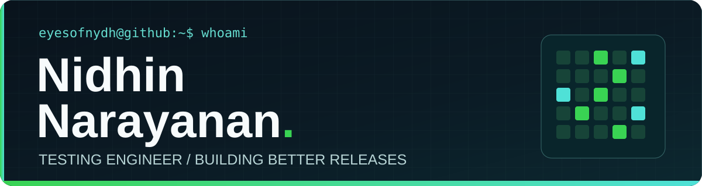

 

<h3>Testing Engineer at Webandcrafts</h3>

I find the cracks before release, then turn the useful lessons into repeatable checks.

<a href="https://nidhinn.online">Portfolio ↗</a> &nbsp;·&nbsp; <a href="https://app.nidhinn.online">NYDH QA ↗</a> &nbsp;·&nbsp; <a href="https://www.linkedin.com/in/nidhin-narayanan/">LinkedIn ↗</a> &nbsp;·&nbsp; <a href="mailto:nidhinxnarayanan@gmail.com">Email ↗</a>

---

## 01 / Selected work

**[NYDH QA Workspace ↗](https://app.nidhinn.online)** — API testing, test cases, and practical QA utilities in one place.

**[Accessibility Tester ↗](https://rbi-accessibility-tester.onrender.com)** — Playwright and axe-core checks with guided manual testing.

**[Site Checks ↗](https://github.com/eyesofnydh/Site-checks)** — A regression suite for responsive layouts, forms, and accessibility.

Appium · Selenium · Playwright · Postman · Jenkins · JAWS

---

## 02 / GitHub in motion

 

---

Testing with curiosity. Building with intent.

