<picture>
  <source media="(max-width: 700px)" srcset="./dashboard-mobile.svg" />
  
</picture>

  
  
  

Appium · Selenium · Playwright · Postman · Jenkins · JAWS

### Selected work

- **[NYDH QA Workspace ↗](https://app.nidhinn.online)** — API testing, test cases, and QA utilities.
- **[Accessibility Tester ↗](https://rbi-accessibility-tester.onrender.com)** — Playwright and axe-core checks with guided manual testing.
- **[Site Checks ↗](https://github.com/eyesofnydh/Site-checks)** — A regression suite for responsive layouts, forms, and accessibility.
